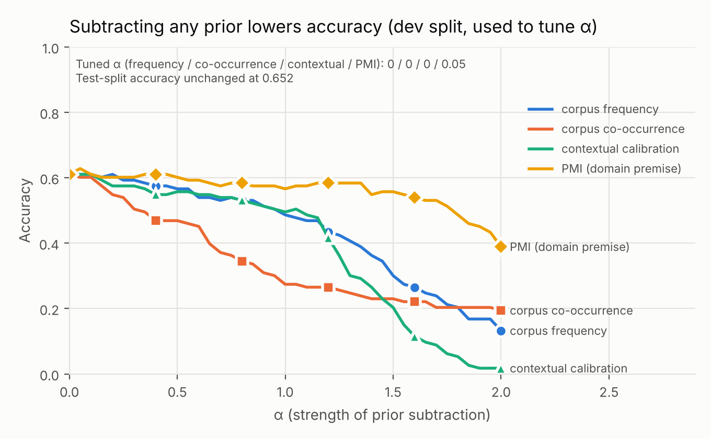
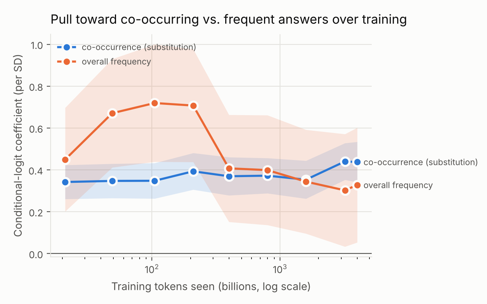

# Frequency Substitution in Language Models

> **Evidence correction, 2026-11-14 Pacific time.** This is the historical report,
> not a verified reproduction. The checkout tracks aggregate JSON and manifests
> but lacks the original candidate scores, sampled windows and prediction rows.
> The claim below that every number can be regenerated from `artifacts/` is false.
> The reported gold-exposure slope `0.438 - 0.077 = 0.361` is invalid because
> the two regressors were standardized separately. The H5 “counts only” detector
> uses the model's chosen answer and subject popularity; it is not output-free.
> The selected H4 policies did not improve held-out accuracy, and α=0 for three
> methods is a no-op rather than evidence that every nonzero correction fails.
> The H2 trajectory and H3 test cannot be independently verified from tracked
> question-level outputs. The original country test is spent. The new,
> wrong-answer-specificity study is specified in [WRONG_ANSWER_PLAN.md](WRONG_ANSWER_PLAN.md)
> and has no empirical result yet.

*Historical narrative. The tracked aggregate JSON supports arithmetic checks, but the original row-level inputs are missing. The number of local test accesses is unverified.*

## 1. Question
When a language model gets a fact wrong, is its wrong answer predictable from indexed source text? The historical study used OLMo-2 1B and an infini-gram index of its stage-1 source mixture. Exact model exposure to individual indexed occurrences is unverified.

The hypothesis separates two effects:
- **Marginal-frequency bias:** the model prefers answers that are common overall. This is known; see "Calibrate Before Use", Zhao et al. 2021.
- **Co-occurrence substitution:** the model prefers wrong answers that frequently appear *near the subject* in training data. This is the claim tested here.

## 2. Setup
| Component | Choice |
|---|---|
| Model | `allenai/OLMo-2-0425-1B`, final **stage-1** checkpoint (`stage1-step1907359-tokens4001B`). Stage 1 only, because mid-training data isn't in the index |
| Corpus | OLMo-mix-1124, via the infini-gram index `v4_olmo-mix-1124_llama` (4.58T tokens) |
| Questions | PopQA `country` relation: 838 questions, 107 possible answers |
| Candidates | All 107 countries, scored for every question (no candidate sampling) |
| Scoring | Exact summed log-probability of " " + answer after a 4-shot prompt. A prefix-cached scorer, verified against a naive scorer to within 5×10⁻⁷ |
| Splits | Subject-level dev (20%) / test (80%), stratified by popularity. Every design choice was made on dev; test was run once |

## 3. Measuring training-data co-occurrence
infini-gram's AND-queries turned out to be unusable for frequent terms. They are approximate and inconsistently biased downward: "Barack Obama AND Honolulu" returns 152, 4,804 or 274,853 depending on the parameters. Instead we use a **sampled-context estimator**:
1. Find every occurrence of the subject in the corpus. That count is exact.
2. Sample 50 occurrences uniformly at random.
3. Fetch about 200 tokens of text around each one.
4. Record which countries are mentioned there.

Under complete uniform retrieval, the raw share is unbiased for **returned-window string hits**, with a finite-population sampling error. It is a census when all occurrences are retrieved and none is blocked. It is not an unbiased estimate of a factual relation, and the later `log1p` transformed feature is not unbiased in the same sense.

**Data-quality rules,** decided from strings, counts and labels alone. The first three were set before any model outputs existed; the label policy was set after a dev-only pipeline dry run, before any test-split analysis:
- Wikidata alias codes that collide with English words are filtered out ("in" for India, "be" for Belgium, …).
- Ambiguous subjects ("Cave", "Tina", "Dublin") are flagged by their corpus-mentions-per-pageview ratio and excluded from the primary analysis.
- Questions whose gold answer is a historical or constituent state are excluded (Kingdom of Saxony, Wales, …).
- Duplicate labels for the same state are merged.

## 4. Analysis (pre-registered: `preregistration.md`)
- **H1 (primary):** a conditional logit of the model's choice over the 107 candidates, with features:
  - log co-occurrence;
  - gold × log co-occurrence, which separates "exposure to the true answer helps" from "attraction to co-occurring wrong answers";
  - log corpus frequency, log Wikipedia popularity and answer length as controls;
  - is-gold.

  H1 is supported if the 95% CI of the co-occurrence coefficient lies above 0.
- **H2:** the same model refit at 9 stage-1 checkpoints, from 21B to 4,001B tokens.
- **H3:** exact direct logit attribution localises the components that push toward the wrong answer (discovered on dev). Mean-ablating them is tested on full-answer scores on test, against 20 random component sets, with a no-ablation control that must be exactly 0.
- **H4:** subtracting a prior from candidate scores (corpus frequency, corpus co-occurrence, contextual calibration, PMI_DC), with α tuned on dev and accuracy compared on test, overall and on rare facts.
- **H5:** predicting errors from model confidence, corpus counts, or both (fit on dev, AUROC on test).

## 5. Results (TEST split, run once, as pre-registered)

### H1 (primary): archived positive all-choice association
460 test questions (non-ambiguous subjects, label policy applied); accuracy 65.2%; 160 wrong answers.

| Feature (z-scored) | Coefficient | 95% CI |
|---|---|---|
| **log co-occurrence (non-gold candidates)** | **0.438** | **[0.341, 0.534]** |
| gold × log co-occurrence | −0.077 | [−0.115, −0.039] |
| log corpus frequency | 0.328 | [0.054, 0.602] |
| log Wikipedia popularity | 0.767 | [0.528, 1.007] |
| answer length (tokens) | −0.084 | [−0.196, 0.027] |
| is gold | 4.450 | [4.116, 4.783] |

- **Size:** in the archived all-choice regression, one standard deviation more measured co-occurrence for a non-gold candidate is associated with about **1.55×** the relative odds of selection, conditional on the listed controls. This does not directly evaluate which wrong answer wins *conditional on an error*.
- **Gold-answer exposure:** the originally reported combined coefficient +0.361 is invalid because the main and interaction regressors were standardized separately. Its slope and interval cannot be recovered from the aggregate artifact.
- **Rank test:** chosen wrong answers sit at the 63.2nd percentile of co-occurrence among wrong candidates (95% CI 59.9–66.8; null 50; p = 0.0001).
- **Within-question OLS** on the full log-prob distribution agrees (β = 0.279 [0.234, 0.324]).
- **Measurement uncertainty:** 50 sampled windows yield many zeros for rare mentions. Nonlinear transformation, blocked retrieval, surface ambiguity and omitted plausibility can bias the fitted coefficient in either direction. The archived result does not establish a lower bound on the association.
- **Robustness:** every check has a positive coefficient with a CI above 0.
  - Both other prompt templates: 0.418 and 0.501.
  - Length-normalized scoring: 0.391.
  - Raw p̂ in place of log co-occurrence: 0.272.
  - Excluding questions whose gold answer appears in the demos: 0.454.
  - Including label-ambiguous golds: 0.438.
  - The dev split: 0.532.
  - **Including the 177 ambiguous-name subjects** (n = 637): **0.618 [0.545, 0.691]**.
- **Dose-response by name ambiguity** (exploratory, not pre-registered as a hypothesis): the effect grows with how ambiguous the subject's name is in the corpus, by ambiguity tercile 0.276 [0.160, 0.392] → 0.532 [0.385, 0.678] → 0.626 [0.491, 0.761], while accuracy falls in the most ambiguous tercile (0.659 → 0.659 → 0.540). That fits the model leaning on surface name–answer co-occurrence when a name doesn't pin down one entity.


### H5: archived error-prediction gain
| Features | AUROC (detecting errors) | AURC ↓ | Accuracy at 50% coverage |
|---|---|---|---|
| Model confidence | 0.893 | 0.113 | 0.922 |
| Chosen-answer corpus features and subject popularity | 0.847 | 0.140 | 0.883 |
| **Both** | **0.924** | **0.099** | **0.935** |

The stored summary reports an AUROC difference of **+0.031 [+0.013, +0.051]** (question-level bootstrap, 2,000 resamples), but its interval cannot be recomputed without prediction rows. The corpus-feature comparator requires the model's chosen answer and subject popularity; it is not an output-free detector.

### H4: selected score corrections did not improve accuracy
The 41-point development curves are not monotone. The selected strength was 0 for corpus frequency, corpus co-occurrence and contextual calibration, and 0.05 for PMI. All selected policies matched the uncorrected test accuracy (65.2% overall; 64.9% on the defined rare subset).

The answer distribution is skewed toward frequent countries ("United States of America" is the raw gold answer for 33% of country questions), which is one possible explanation. The selected policies did not improve test accuracy. Three selected α=0 and therefore changed nothing; this does not establish that every nonzero correction hurts.



### H3: archival mechanism summary, not independently replayable
- **Logit lens** (160 of 168 test wrong answers are first-token cases): the gold and the chosen wrong answer are tied through layer 9. The wrong answer pulls ahead in **layers 10–13**, peaking at layer 13 (−4.0 logits), and the last two layers recover part of the gap.
- **Exact direct logit attribution** (decomposition error < 10⁻⁵): the largest pushes toward the wrong answer come from **attention in layers 13 and 15** and from layer 12.
- **Causal test:** mean-ablating the 3 dev-selected components (L13 attention, L15 attention, L12 MLP) at the answer position, with full answers rescored pairwise:

| | Wrong answers flipped to correct (n = 168) | Correct answers broken (n = 319) |
|---|---|---|
| No ablation (control) | 0% | 0% |
| **Top-3 components** | **11.9%** | **12.5%** |
| 20 random 3-component sets | mean 4.0% (95th percentile 8.7%) | mean 3.3% |

- **Archived verdict:** the selected components fail the joint rule because collateral damage exceeds the registered limit. The row-level interventions are absent, and a pairwise gold-versus-old-winner flip is not a full-pool correction. A substitution-specific circuit is unverified.
- Finding a substitution-specific circuit would need finer units (individual attention heads) or path patching. That's out of scope for the MVP.


### H2: training dynamics (archived aggregates; common-cohort rows unverified)
The tracked `dynamics.json` reports the following table. The same-cohort rows and exact prompts cannot be checked from this checkout:

| Tokens seen | Accuracy | β co-occurrence [95% CI] | β overall frequency [95% CI] |
|---|---|---|---|
| 21B | 0.457 | 0.342 [0.261, 0.423] | 0.449 [0.201, 0.697] |
| 49B | 0.504 | 0.347 [0.265, 0.429] | 0.671 [0.412, 0.930] |
| 105B | 0.543 | 0.348 [0.263, 0.433] | 0.719 [0.439, 1.000] |
| 210B | 0.593 | 0.393 [0.306, 0.481] | 0.707 [0.438, 0.977] |
| 399B | 0.596 | 0.369 [0.278, 0.461] | 0.407 [0.151, 0.663] |
| 797B | 0.567 | 0.372 [0.288, 0.457] | 0.399 [0.137, 0.661] |
| 1,594B | 0.593 | 0.353 [0.262, 0.444] | 0.344 [0.096, 0.592] |
| 3,209B | 0.607 | 0.440 [0.352, 0.528] | 0.302 [0.033, 0.571] |
| 4,001B | 0.652 | 0.438 [0.341, 0.534] | 0.328 [0.053, 0.602] |

- The archived table reports positive coefficients at each checkpoint. The candidate-score and analysis rows needed to verify a complete common-cohort trajectory are absent, so a stable-through-training conclusion is unverified.
- **The pull toward overall-frequent answers** rises early, peaking around 105–210B tokens, then declines to about 0.30–0.33. The frequency CIs are wide and overlap across checkpoints, so this trend is suggestive, not established.
- That interpretation remains a hypothesis until the checkpoint rows can be replayed.



## Summary of verdicts
| Hypothesis | Pre-registered test | Verdict |
|---|---|---|
| H1 co-occurrence substitution | β(log co-occurrence) CI > 0 | **Nominally supported in archived all-choice summary**: 0.438 [0.341, 0.534]; raw rows absent |
| H2 training dynamics | descriptive | Archived trajectory only; common-cohort replay unverified |
| H3 mechanism | top-3 ablation flip rate > random 95th percentile, collateral < 2× random | **Not implicated**: flips 11.9% (random 95th percentile 8.7%) but collateral 12.5% (2× random = 6.6%) |
| H4 prior subtraction | rare-fact accuracy gain CI > 0 | **Not supported**: selected policies gave no held-out accuracy gain; three selected α = 0 |
| H5 error prediction | AUROC(combined) − AUROC(confidence) CI > 0 | **Supported**: +0.031 [+0.013, +0.051] |

## 6. Limitations
- **One relation:** `country`, with a 1B model. Generalisation to other relations and scales is untested in the MVP.
- **Exposure approximation:** per-checkpoint exposure assumes a shuffled data order.
- **Co-occurrence is not a relation:** it is measured within about 200-token windows, so it doesn't distinguish *how* two entities are related.
- **First-token attribution:** DLA and the logit lens use first tokens. This covers 160 of 168 test errors, and the ablation itself is evaluated on full answers. Components are layer-level, not individual heads.
- **Sampling error:** the estimator uses K = 50 windows per subject, so rare co-occurrences (under about 2% of windows) are often estimated as 0.

## 7. Deviations from the pre-registration (all logged in `preregistration.md`, all made before any test-split analysis)
1. **Label policy:** "Netherlands" and "Kingdom of the Netherlands" were merged, and 5 questions with historical or constituent-state golds were excluded from the primary sample (included as a robustness check, with an identical β).
2. **Input-resolution bug:** stages had selected inputs by directory mtime, and a tie silently picked an obsolete counts run. Inputs are now resolved by config hash, and co-occurrence was recomputed on the correct counts.
3. **Demonstrations:** all scoring runs used demos selected under the earlier ambiguity flag (one demo, "Norfolk", would be flagged under the final rule). They were kept and frozen for identical prompts everywhere, and verified by a test.
4. **One rerun of H1 on test:** after context sampling for ambiguous subjects finished, purely to complete that robustness check. The primary estimate was identical.

## 8. Reproducing
See `README.md` for setup. Stages in order, each resumable and writing a manifest (config, git SHA, package versions):
```bash
python scripts/01_build_data.py
python scripts/02a_entity_counts.py
python scripts/02b_contexts.py                      # infini-gram, ~0.9 req/s, cached
python scripts/04_score.py "templates=[qa]"         # plus question_answer and instructed
python scripts/05_checkpoints.py "templates=[qa]" question_subset=primary_test
python scripts/06_analyze.py split=test             # H1
python scripts/07_interp.py eval_split=test k=3 max_cases=1000   # H3
python scripts/08_calibrate.py final_test=true      # H4
python scripts/09_dynamics.py split=test            # H2
python scripts/10_detect.py eval_split=test         # H5
python scripts/make_figures.py
```

## Notes on superseded artifacts
`artifacts/07_interp/5f7cb6f0eb9e/results.json` comes from an early H3 dry run with a saturated metric, since fixed. Ignore it.
