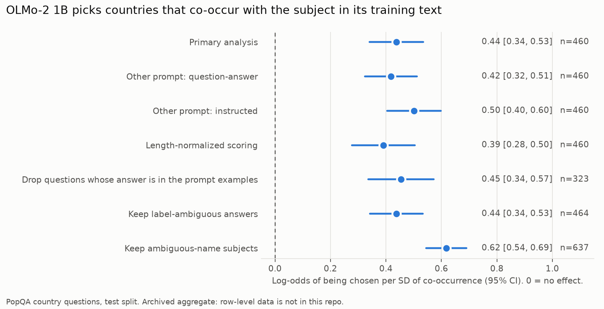

# Frequency Substitution in OLMo-2 1B: Summary

**When OLMo-2 1B gets a country question wrong, the country it picks tends to be one that appears near the subject in its training text.** The chosen wrong country sits at the 63rd percentile of co-occurrence among wrong candidates (95% CI 60–67; chance is 50). Across all 107 candidates, one SD more co-occurrence gives a candidate about 1.55× the odds of being chosen (log-odds 0.438 [0.341, 0.534], 460 test questions).

> **Status:** archived result. The row-level data is not in this repo, so these numbers can't be refit here. Full details are in [REPORT.md](REPORT.md). A new held-out study has no result yet (see Next step).



## Question
When a language model gets a fact wrong, is its wrong answer predictable from its training text? The question separates two effects: a general preference for answers that are common overall (known, see "Calibrate Before Use") and a preference for wrong answers that appear *near the subject* (tested here).

## Setup
| | |
|---|---|
| Model | `allenai/OLMo-2-0425-1B`, final stage-1 checkpoint |
| Corpus | OLMo-mix-1124, 4.58T tokens, searched with infini-gram |
| Questions | 838 PopQA `country` questions, 107 candidate answers, 4-shot prompt |
| Candidates | all 107 scored for every question |
| Test split | 460 questions with unambiguous subjects; accuracy 65.2%, 160 wrong answers |
| Model fit | conditional logit; controls for corpus frequency, Wikipedia popularity, answer length |

## Method: sampled-context estimator
infini-gram's co-occurrence queries were unstable for frequent terms (the same query, "Barack Obama AND Honolulu", returned 152, 4,804 or 274,853 depending on parameters). I replaced them with a sampled-context estimator: count the subject exactly, sample 50 occurrences, read about 200 tokens around each, and record which countries appear.

## Results (test split)
| Test | Result | Status |
|---|---|---|
| **H1** Do wrong answers track co-occurrence? | Yes: 0.438 [0.341, 0.534]; positive under every robustness check | Supported (archived) |
| **H2** Is that stable through training? | Coefficient 0.34–0.44 at all 9 checkpoints (21B–4T tokens), every CI above 0 | Archived aggregate, not replayed |
| **H3** Are late-layer components specific to substitution? | Top-3 components fix 11.9% of errors but break 12.5% of correct answers (random sets: 4.0% and 3.3%) | No: general answer selection |
| **H4** Does subtracting a frequency prior help? | Accuracy unchanged at 65.2% | No (null) |
| **H5** Do corpus features help detect errors? | AUROC 0.893 → 0.924 (+0.031 [0.013, 0.051]) | Supported, but see limits |

## Limits
- **1.55× is an all-candidate odds ratio**, not "which wrong answer wins given an error". The 63rd-percentile figure is closer to that question.
- **One relation, one 1B model.** Co-occurrence in 200-token windows is not a stated relation, and sampling 50 windows misses rare mentions.
- **H5's corpus features use the model's chosen answer**, so it is not a detector that works without the model's output.
- **Not replayable here:** the row-level data is missing, so H2, H3 and H5 intervals can't be recomputed. The old gold-answer slope (+0.361) was invalid and is withdrawn.
- **No novelty claim.** The broad idea was studied by [Kang and Choi (2023)](https://aclanthology.org/2023.findings-emnlp.518/).

## Process
Pre-registered, with deviations logged in [preregistration.md](preregistration.md). 53 tests pass. The original country test split is spent, and the number of local test accesses can't be verified.

## Next step
A new `occupation` study asks which wrong occupation the model picks beyond what a fixed per-label preference predicts. That baseline alone beats uniform choice (log loss 2.24 vs 4.42). Next: finish corpus counts for the 80 development errors (an API rate limit stopped the last attempt), review labels by hand, then score the 421 held-out questions once. See [WRONG_ANSWER_REPORT.md](WRONG_ANSWER_REPORT.md).

## Reproduce
```bash
.venv/bin/python -m pytest -q                      # 53 tests
.venv/bin/python scripts/make_summary_figure.py    # regenerate the figure from tracked results
```
Rerunning the country pipeline (stages in [REPORT.md](REPORT.md) section 8) needs the infini-gram API at about 1 request per second and an OLMo-2 1B run. I haven't rerun it end to end, and no single command does it.

Repo: https://github.com/ericniu0218/freqsub-nlp
